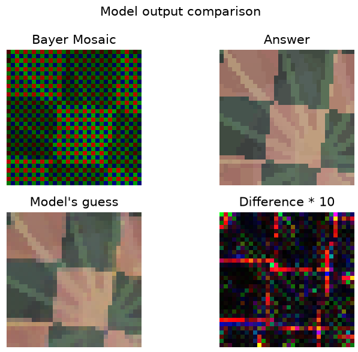

# Machine Learning Demosaicer

This project utilizes a convolutional neural network to de-mosaic raw camera sensor data (mosaics) into full-RGB images.

## Setting up the project

### Install `uv`

The instructions for installing `uv` can be found [here](https://docs.astral.sh/uv/getting-started/installation/).

### Clone the Repository

in your desired parent folder, run the following:

`git clone https://github.com/matt-bowlby/ml-demosaicer`

### Install Dependencies

Run the following from inside the project directory:

`uv sync`

Dependencies should install.

### Run the Project

From inside of the project directory, run the following command after dependencies have installed:

`uv run main.py`

The CLI should pop up, asking where you want to store your training runs. If you see this, the install was successful.

## Using the Project

After setting up where training runs will be stored, you will see various options:

```md
Welcome to the ML Demosaicer CLI.
What would you like to do?
1. Start a new training run
2. Continue a previous training run
3. Evaluate a previous training run
4. Edit the default train configuration
5. Edit the default eval configuration
>
```

Enter the number of what you want to do. Default train and eval configurations are what populate configurations used by option 1 (Start a new training run) and option 3 (Evaluate a previous training run).

If option 2 (Continue a previous training run) is selected you will be asked to enter the name of the run, and the training configuration that was used last will be populated. When done editing the configuration, training will pick up at the seed it left off on.

When evluating or training, you are given the option to edit the confuration. For example, when training a model, you will see a configuration menu like this:

```md
Configure training
1. Done
2. Image width: 32
3. Image height: 32
4. Training seed range start: 0
5. Training seed range end: 999999999
6. Learning rate: 0.0005
7. Batch size: 5
8. Batch count: 20000
9. Epoch count: 1
10. Image generation version: 1
11. Weight seed:
12. Single image: False
>
```

Simply enter the number of what you'd like to change, and then enter the new value. If "Single image" is set to `True`, it will ask you what seed you want to use for single image training. This seed will be trained on for the full extent of the training run, allowing you to test on problematic images or to prove to yourself at 2 A.M. that yes, Matt, your machine learning model actually does work and was not a waste of time. Or something like that.

When done configuring, enter 1 and training or evaluation will proceed.

## Background: What is Demosaicing?

A camera sensor is made up of millions of "photosites," each of which represents a single pixel in the final image. These photosites are individual light sensors which capture the brightness of the light that lands on them. Each photosite has one of three filters on top: Red, Green, or Blue; as a result, each photosite only captures one of the three possible RGB values of the light that lands on them. The pattern at which the R, G, and B photosites are arranged is called a mosaic. The classic mosaic pattern is a [Bayer Mosaic](https://simple.wikipedia.org/wiki/Bayer_filter#/media/File:BayerPatternFiltration.png), but there are many others (such as [X-Trans](https://www.darktable.org/2014/08/using-x-trans-cameras-with-darktable/bayer_vs_xtrans.png)).

No matter which mosaic you choose, they all share the same problem: The moment you hit the shutter button on the camera, you are discarding 2/3rds of the light data that lands on them. This is the process of demosaicing: taking this mosaic and inferring the values of the missing channels (e.g. for a green photosite, inferring the red and blue channels, etc.) based on the photosites around them.

A naive approach would be to simply average the nearby values in order to fill in the blanks. This may work for smooth textures, but fails catastrophically in the case of hard edges. For example, in an extreme case where one side of your image is black and the other is white, such a naive approach would "hallucinate" a non-existent grey column of pixels between the two sides. Suddenly, the process of demosaicing becomes much more scintillating.

Many manual algorithms have been applied to this problem (Nearest Neighbor, Bilinear Interpolation [the "naive solution" mentioned above], AHD, VNG, AMaZE, etc.) but the issue of these manual algorithms is that they can rudely pave-over some of the intricate inter-pixel relationships.

That is where the idea for this project comes in: train a convolutional neural network to be able to learn these inricate pixel-to-pixel relationships, enabling a more accurate demosaicing that can deal with each pixel individually.

## Data Source

In order to train this algorithm with inputs (mosiacs) and outputs (full-RGB images), I decided that instead of taking numerous raw photo mosaics and demosaicing them using an existing software (which would only result in the model learning how to replicate that particular demosaicing algorithm), I would instead work backwards: Take a full-RGB image, sample a mosaic from it, and then train the model on that. This allows us to train the model with a mosaic while knowing exactly what the missing RGB values should be, enabling the algorithm to train off of ground-truth rather than a different algorithm's guess.

### Image Generation

Rather than download tens of thousands of images, I decided it would be worth implementing a simple image-generation algorithm. Don't be fooled: This is no AI image generation algorithm. It is a collection of simple shape and texture functions that can be stacked on one another at random, to produce smooth gradients and hard edges---a rough approximation for a real-life photo.

There are numerous upsides of this:
1. With seed-based random generation, each image is defined simply by its seed, and a particular training run is defined by a range of said seeds.
2. Images can be generated on the fly and quickly discarded, taking up no disk space and little ram. This also cuts out the time penalty of loading images from disk during training.
3. No need to worry about training on others' images or stepping on anyone's toes; all images are made in-house, from-scratch.
4. We have full control over the dataset, and can tweak it as needed with plenty of granularity.
5. Functionally infinite images: I've limited the training set to a one-billion images and the evaluation set to one-billion images, but this can easily be changed in the config to be as large as desired.

## Current State of the Model

I haven't achieved the lofty goals I've had for this project, but I feel satisfied leaving it where it is. After training a model on 60,000 32x32 images, I achieved this result:



As can be seen, it struggles with edges and smaller details in much the same way I condemned bilinear interpolation for above. Oh, the irony.

## Future Improvements

If I ever come back to this project, these are the various improvements I would make:

1. **Optimize the image generation algorithm for the GPU:** Right now, image generation runs on the CPU, which is the largest bottleneck for the training process at the moment. In order to convert it to the GPU, native GPU-friendly implementations of the following would need to be made:
   1. All of the utilized shape functions from the Pillow library
   2. Generation of Simplex noise
2. **Add GAN to the training repertoire:** I've done what I can to optimize for edge preservation, but the reality of imperfection still bears heavy on me. The next step would be to implement an independent adversarial classification network to help teach the generation model a lesson (in a good way.)
3. **Scale up to full-size images:** Obviously, modern cameras take photos at a resolution larger than 32x32. This was the resolution I was working with in order to make debugging the model much quicker (and to save on my electricity bill), but the long-term plan was always to scale up. Technically, it already *can* be scaled up, but training would take *weeks to months* as improvement #1 has not been implemented yet.
4. **Train on more data:** It might be hard to believe, but I found through experimentation that as you trained on more data, the model's performance actually improved! I can foresee a potential future in which improvement 2 is not necessary, and all it needs is just to see millions-to-billions of images. Once again, testing of this is bottle-necked by improvement #1.
5. **Native Rust Implementation:** Once the final model weights are reached, I was planning on running the model in rust for ultra-fast demosaicing and packaging it as a rust crate.